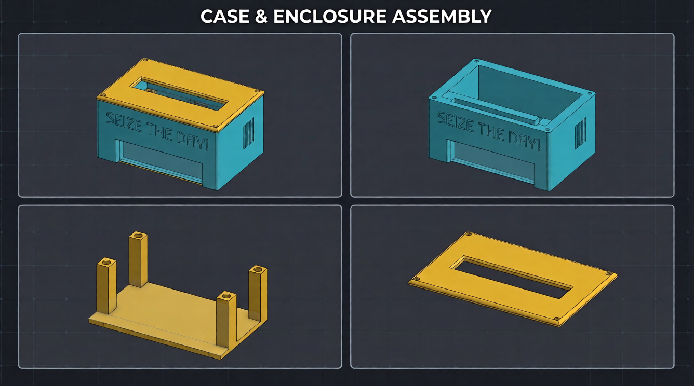

# Blare

BLARE is an open-source, custom desktop digital alarm clock powered by the Seeed Studio XIAO ESP32-C3 microcontroller. It features 4 direct-wired MX mechanical switches for menu navigation, a 3.3V piezo buzzer for audio alerts, and a 2.25" ST7789 wide-aspect TFT display (284x76), all housed in a custom 3D-printed case.

# Features

- **4-Key Control Deck:** Direct-soldered MX-style mechanical switches with blank DSA keycaps for menu navigation and alarm control.
- **2.25" ST7789 TFT Display:** 284x76 resolution color LCD driven via hardware SPI through an 8-pin 2.54mm header for timekeeping and menu UI.
- **3.3V Piezo Buzzer:** Dedicated PWM/digital audio output for pulsing alarm tones.
- **Custom CAse:** 3-piece 3D-printed case designed in Onshape.
- **Firmware:** Powered by C++ (Arduino framework) using a `millis()`-based state machine to handle timekeeping, screen updates, and alarm pulsing simultaneously without freezing button inputs.

# Control Map & Pinout

### Mechanical Switches (Active-Low with Internal Pull-Ups)
- **SW1 (`D0`) - Mode:** Cycles between the live clock screen, Time Set mode, and Alarm Set mode.
- **SW2 (`D1`) - Up:** Increments the selected hour/minute value or toggles the alarm ON/OFF.
- **SW3 (`D2`) - Down:** Decrements the selected hour/minute value or toggles the alarm ON/OFF.
- **SW4 (`D3`) - OK / Dismiss:** Confirms the current setting selection or silences an active ringing alarm.

### 2.25" ST7789 TFT Display (8-Pin Header via SPI)
- **DC (Data/Command):** Connected to `D4`
- **CS (Chip Select):** Connected to `D5`
- **BL (Backlight):** Connected to `D6`
- **RST (Reset):** Connected to `D8`
- **SCLK (SPI Clock):** Connected to `D9`
- **MOSI (SPI Data):** Connected to `D10`
- **VCC / GND:** Connected to `3V3` and `GND`

### Audio Output
- **3.3V Piezo Buzzer:** Positive lead connected to `D7`, negative lead to `GND`.

*(All buttons and display output can be changed in the firmware file.)*

.png)

# Case & Assembly Fit

The enclosure consists of a main body and a front faceplate/cover designed to fit together cleanly:
- The **PCB** mounts onto internal standoffs in the bottom shell using **M3x8mm screws** threading into **M3x5x4 heat-set brass inserts**.
- The **2.25" TFT Display** sits in the top viewing window and connects to the PCB's 8-pin male header underneath using 20cm Female-to-Female jumper wires.
- The **4 MX Switches** snap into the switch plate cutouts right below the screen for easy thumb/finger reach to dismiss alarms.
- The two halves of the case close together and lock via **M3x16mm screws** into heat-set inserts, leaving a side cutout accessible for the XIAO ESP32-C3 USB-C power/programming cable.

# Project Structure

Blare
CAD
 -Individual Files
  -Base.step
  -PCB 3D model.step
  -Top.step
  -walls.step
 -BLARE.step 
firmware
 -Blare
  -Blare.ino
Images
 -3d model case wall.png
 -Bottom 3d model base.png
 -combine.png
 -Complete case.png
 -PCB.png
 -PCB 3d model bottom view.png
 -PCB 3d model top view.png
 -result_0(2).png
 -Schematic.png
 -Top.png
PCB
 -Blare
  -Blare.kicad_pro
  -Blare.kicad_pcb
  -Blare.kicad_sch
 -Blare PCB all files
 -.history
Production
 -Base.step
 -Top.step
 -Walls.step
 -Gerbers.zip
.git
BOM.csv
README.md 
.gitattributes

NOTE :- PLEASE CHECK THE BOM.csv FOR THE MATERIALS

# Assembly Instructions

    PCB Fabrication: Upload PCB/gerbers.zip to a PCB manufacturer (such as JLCPCB) with standard 1.6mm thickness and default 2-layer settings.

    3D Printing & Heat-Set Inserts: Print the three enclosure parts (Top.step, Walls.step, and Base.step). Use a soldering iron to press the M3x5x4mm brass heat-set inserts into the 4 pillars on the bottom mounting base and the PCB mounting points.

    Component Soldering:

        Solder the Seeed Studio XIAO ESP32-C3 microcontroller, the 3.3V piezo buzzer (BZ1, observing + polarity), and the 1x8 2.54mm male pin header (J1).

        Solder the 4 MX-style mechanical switches (SW1–SW4) onto the front switch pads.

    Display Wiring: Connect the 2.25" ST7789 TFT display to the 8-pin header (J1) on the PCB using the 20cm Female-to-Female jumper wires according to the SPI pinout above.

    Enclosure Assembly: Mount the PCB inside the main case wall with the 4 switches facing out of the lower front cutout, seat the 2.25" TFT display into the upper slot, slide the 4-pillar bottom base up from underneath, place the top faceplate bezel over the screen, and fasten the assembly with M3 screws.

# Firmware Flashing & Setup

 The BLARE Clock runs custom C++ firmware on the Seeed Studio XIAO ESP32-C3 using the Arduino IDE.

    Install Board Support: Open Arduino IDE, add the Espressif ESP32 board manager URL in Preferences, and install the esp32 package by Espressif Systems. Select XIAO_ESP32C3 as your target board.

    Install Libraries: Install Adafruit GFX Library and Adafruit ST7789 (or TFT_eSPI) via the Arduino Library Manager.

    Enter Bootloader Mode (if needed): Hold down the BOOT button on the XIAO ESP32-C3 while plugging the USB-C cable into your PC, or press RESET while holding BOOT.

    Compile & Upload: Open firmware/blare.ino, select the serial port, and click Upload.

    Test: Once flashed, the screen will initialize the 284x76 display, start the clock state machine, and respond to the 4 menu buttons.

# Acknowledgements

    i) Usage of AI for guidance in firmware and debuggin a few PCB errors.

    ii) All external component models and libraries belong to their respective creators (except the custom case and PCB, which you are free to use).

    iii) Created with the guidance of https://blare.hackclub.com/docs/getting-started.

    iv) Built with support from Hack Club grants and resources—massive thanks to them for providing the BLARE kit and making this project a reality.

    v) Built for Hack Club BLARE.

CONTACT INFO :- mandeepswami2010@gmail.com

Suggestions / Issues / Complaint(s) are accepted and appreciated for the betterment of the alarm clock.
