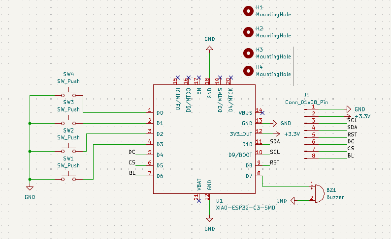
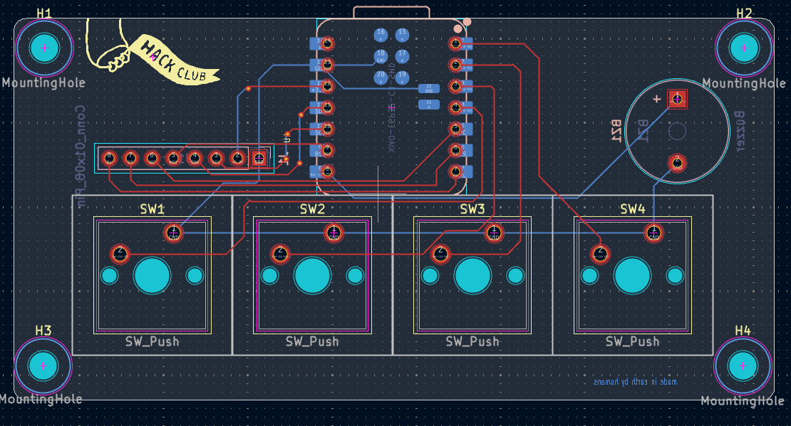

# BLARE
 Blare is a four key alarm clock powered by XIAO ESP32 , a 3.3V piezo buzzer, a 2.25in TFT Screen and a custom PCB built with Onshape(for Case) , Vs code (for readme and BOM) , Kicad (for pcb) and Arduino Ide (for firmware) and also with the help of Hackclub's guide (https://blare.hackclub.com/docs/getting-started) 

#  Features
 Key 1 - Mode button 
  Three modes are there . Normal mode , set alarm hour , set alarm minute.
 Key 2 - Increase Button
  Increase the hours or minutes . 
 Key 3 - Decrease Button
  Decrease the hours or minutes .
 key 4 -
 It has 3 things to do . 
  When alarm is ringing it turns it off.
  When in normal mode turns alarm on or off.
  when in setting alarm mode it acts as a confirm button.
 When alarm is ringing it display WAKE UP

# File structure 
 - CAD  ( contains .step files for 3d models of the case).
 - Firmware contains the firmware code.
 - Images contains Images
 - PCB contains PCB files
 - Production contains files that are to be used to create hardware.
 - BOM.csv contains bill of materials.
 - README.md what you are reading right now .

 

# How to make
 - Order the PCB from a pcb manufacter ( i will use JLCPCB)
 - 3D print the case 
 - Flash the the XIAO with the firmware code 
 - and assemble all of the things .

 

# How to flash 
 - Detailed guide on https://wiki.seeedstudio.com/XIAO_ESP32C3_Getting_Started/

# BUILT WITH 
 - KICAD ( PCB )
 - Onshape ( case )
 - Arduino IDE ( firmware)

# ACKNOWLEDGEMENTS 
 - Built for Stardance Hackclub
 - Funded and built by the support of Hackclub
 - Thanks to Hackclub for providing resources and grants 
 - I dont anything used in this build except PCB , Case and firmware however feel free to use them however you like without restrictions.

Questions , Issues and complaints are accepted . If you have any contact me on my email.
EmaiL :- mandeepswami2010@gmail.com
